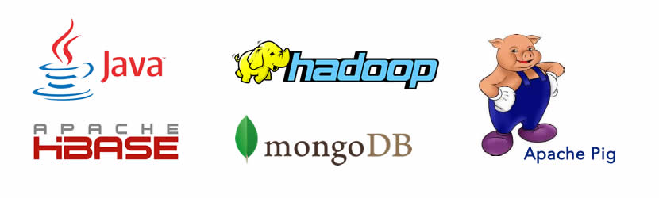
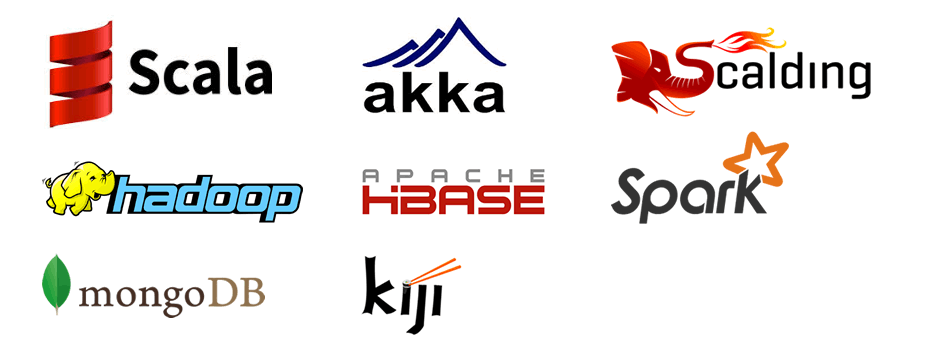

At Indix, we are building the world’s largest product database. We collect product data by crawling product pages from e-commerce web sites. This data goes through a series of data pipelines that extract product attributes and run various machine learning algorithms to classify and match similar products across stores. This data is finally fed into our analytics engine and is exposed via an app and API to customers.

During the last two years, we have scaled our catalog to over hundreds of millions of products, crawled from thousands of sites and we are processing billions of price points daily. In this blog post, I will talk about our experiences in scaling our data platform using Scala.

### HISTORY

We started as a Java shop in Jan 2012.

Why Java? – When you are starting your company and you know that the first couple of iterations of your product will most probably be throwaway prototypes, it’s very important to choose a language that the core engineering team is familiar with. For us, Java was that language.

Don’t worry – if you survive for a year, you will get lots of opportunities to play with the cool languages around (like we did!).

### TECH STACK EVOLUTION

### MARCH 2013

This is how our data platform stack looked like in March 2013, with Java being the core language

### MARCH 2014

And this is how it looked like a year later (March 2014)

Since the middle of 2013, Scala and its ecosystem of tools and frameworks have become an integral part of our tech stack.

### WHY SCALA?

After about a year of making mistakes and learning the domain, we were looking for ways to fix the pain points in our existing data platform. Our data platform consists of a distributed crawler responsible for data ingestion, and a series of data pipelines that process this data using various algorithms and transformations. Scala, the language, with its mix of functional and object oriented paradigms was an ideal choice to build data pipelines. The Scala ecosystem provided us with a rich set of libraries and frameworks that provided the right abstractions to handle most of our problems.

Here’s a brief overview of the Scala frameworks we are currently using.

### AKKA

The initial version of our crawler, which we wrote in the first couple of months after we started, was in production for about a year. It wasn’t feature rich but allowed us to iterate faster and understand the crawling domain. During this time, we also realized that none of the available open source crawlers would be able to support our custom use cases. We decided to build a new crawler from scratch using various open source distributed components as building blocks for storage, fetching and clustering. For clustering, we were looking for a framework that would provide us features like load-balancing, redundancy and no-single-point-of-failure fault tolerance support. We evaluated Gearman, Apache YARN, Netflix Hystrix and Akka on the above criteria. We chose Akka not only because its cluster module satisified all our requirements, but also for its Actor based concurrent framework.

I have built distributed systems earlier and I learned a very important lesson from that experience – building distributed systems is hard because it involves writing concurrent, multi-threaded code, where you end up solving for concurrency bugs that are very difficult to reason. Akka makes it easy to write concurrent code by decoupling your business logic from low-level mechanisms like threads, locks and non-blocking I/O. The secret sauce are Actors, inspired from Erlang.

The new crawler system has been in production for about many months now and crawls millions of URLs per day with an average of a few TB data crawled daily. It runs on a nodes cluster on EC2.

### SCALDING

We have over a 100 batch jobs that run on our Hadoop cluster every day as part of the data pipelines. These jobs structure and analyze our product and price data. The first version of the jobs we wrote used the Java MapReduce API. After writing a handful of jobs we realized that there was lot of boiler plate code being written for each job and we had to write quite a bit of plumbing code to express complex data workflows. We were looking for an abstraction on top of the vanilla MapReduce, that would hide the underlying complexity. We used PIG briefly but we had to learn a new language (PIG Latin) and for anything that the language did not support we had to write UDFs in Java. That’s when we evaluated Scalding.

Scalding, an open source library from Twitter and built on top of Cascading, allows us to use idiomatic Scala – using the collections’ API like map, filter, groupBy etc. to define our MapReduce jobs.

Scalding has made it super easy for us to express complex batch jobs (sometimes involving as many as 8-way joins). It’s become the default choice for writing any MapReduce jobs at Indix.

### SPARK

Spark is the newest entrant into the Scala big data ecosystem at Indix. In cases where your batch algorithms needs to be iterative, MapReduce will not scale well because of the heavy disk I/O required for the intermediate output of each iteration. Spark, a standalone data processing framework, keeps data in memory and provides better execution times for iterative algorithms. We use Spark to cluster products for our Matching engine, that deduplicates similar products across stores. We have a 10 node cluster on EC2 running Spark.

We will cover our detailed experiences of using Akka, Scalding and Spark in subsequent blog posts.

### OTHER SCALA FRAMEWORKS

All the UI that’s required by our data platforms for adminstering and monitoring our data pipelines uses the Play Framework. We are currently investigating SummingBird – another library from Twitter, that allows us to run the same code in both batch and real time modes.

### MIGRATION TO SCALA

The good thing with Scala is that it runs on JVM and allows you to reuse existing Java libraries. We did not have to migrate a lot of existing code. In several instances, we had both Java and Scala code being built as part of the same module.

Following is a list of resources that were most helpful for our team to quickly ramp up on the language.

- [99 problems in Scala](http://aperiodic.net/phil/scala/s-99/)
- [Functional programming course](https://www.coursera.org/course/progfun) on Coursera by Martin Odersky (designer of Scala)
- [Twitter’s scala school](http://twitter.github.io/scala_school/)

Any new engineer or intern joining our data platform team goes through these resources as part of their on-boarding.

### PAIN POINTS

Not everything was smooth sailing for us. There were some pain points during the migration and usage of Scala and its associated frameworks which can be broadly classified into the following three areas:

- *Version incompatibility* – This has been one of the major pain points for us. We use Scala 2.10 for most of our internal Scala libraries. The version of Akka that we were using was also built with Scala 2.10. However, the versions of Scalding and Spark were still using 2.9 which made it difficult for us to share our data models. Over the course of the last year, these incompatibilites have accumulated as technical debts. Once every few weeks, we take a couple of days off to migrate our libraries from 2.9 and 2.10. We are doing one of those exercises as I write this blog post.
- *Message passing using Actors in Akka* – There was a learning curve when we started using Akka, primarily because of how Actors communicate. They use asynchronous message passing. You cannot call any methods on Actors. The only way to communicate with them is by passing messages. Unlike RPC, you have to write additonal code to manage reliabilty and synchrony, which becomes an additional burden on the developer. During deployment, we ran into a couple of issues running our crawler on EC2, one of which is described in [this](https://groups.google.com/forum/#!msg/akka-user/RYxaPl_nby4/PYEb0SqgTa8J) mail thread on the Akka forums. We eventually solved it by tweaking the failure detector parameters after multiple trials and errors spanning couple of weeks.
- *Compile times* – We definitely miss the instant feedback we got when we would compile or run unit tests in Java. Having said that, we are not terribly unhappy with the compile times and feedback we get with Scala. I think the primary reason is that we do not have very large projects. Our project respositories do not have more than 3 or 4 modules. Also, external compiler and incremental compilation support provide by the IDE (we use IntelliJ Idea) has been a big help.

### SUMMARY

Scala, the language, and the frameworks and tools available in its ecosystem have made the developers at Indix more productive than they were a year ago. The shift to Scala and as a result to functional thinking has allowed us to build more scalable, robust and fault tolerant systems.
