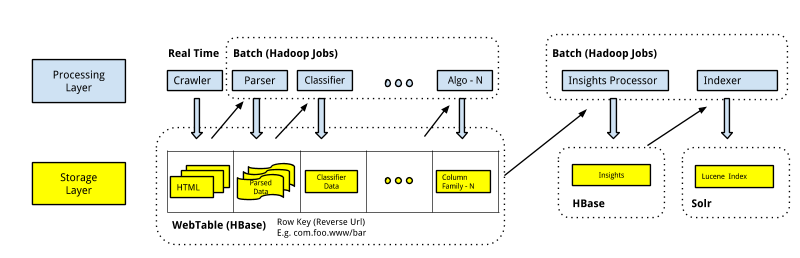
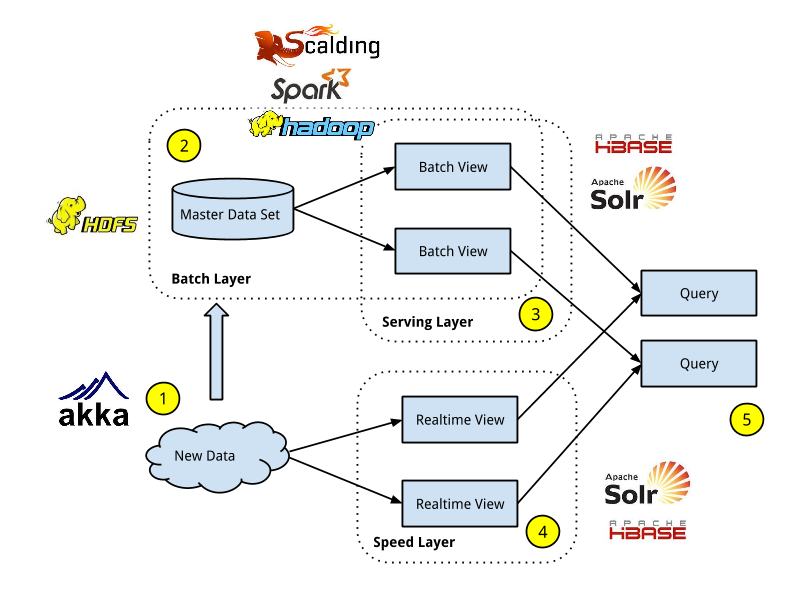

*This post is the first in a series of blog posts that will go in depth over our implementation of Lambda Architecture for building the big data pipeline at Indix.*

### Background

[Indix](http://www.indix.com) is a product intelligence platform. We are building the world’s largest product database and APIs to enable brands, retailers and developers to deliver the right product to the right customer at the right place, every time.

During the last two years, we have built a catalog of several million products and billions of price points collected from thousands of e-commerce websites. We collect product data as semi-structured HTML via crawling product pages from these websites. Our parsers extract product attributes from the pages. The resultant structured data is then run through a series of machine learning algorithms to classify and extract deeper product attributes, and products get matched across stores. Our analytics engine uses this data to compute aggregates across multiple dimensions and derive actionable insights. This data is also indexed by our search engine. All this data is then consumed by our apps, API and mobile platforms.

The use cases above pose unique and interesting challenges on our data platform in terms of scale, performance, availability, manageability and cost.

### Data Platform v1.0

After couple of false starts, the first “stable” version of our data platform is represented in the diagram below.

We were looking for a data model that would allow us to keep a copy of millions of web pages collected by our crawler and related information that would be used by our downstream systems – Machine Learning, Analytics and Search.

We finally ended up using [HBase](http://hbase.apache.org/), an open source implementation of [Google BigTable](http://static.googleusercontent.com/media/research.google.com/en//archive/bigtable-osdi06.pdf) to implement our storage layer. The URL of a web page was the row key. We used multiple column families to store additional information related to the URL. For example, the crawlers would store the HTML page contents in the content column family. Likewise, parsers that are responsible for extracting key price and product attributes from a product web page stored the parsed data as a JSON in another column family.

Our processing platform consisted of a series of [Hadoop](http://hadoop.apache.org/) MapReduce jobs that would run various ML algorithms on the HBase table to augment the URL row with semantic content including category annotations and tags. These MR jobs would scan the entire table, and were chained together so that each job would read the content from the previous job’s output and write the output to their corresponding column families. We were able to store multiple versions of most of this content using the timestamp based versioning provided by HBase. For example, we were storing the last five versions of the crawled product page and all the versions of the parsed price and product data.

This data would then be exported daily to the analytics system which would run another series of MapReduce jobs to aggregate, calculate derived fields and run precomputations across several dimensions. The output of these jobs was bulk-imported into a HBase table. A snapshot of this data was used as the input to generate the Lucene index used by Solr. Finally, all this data was exposed through service endpoints to be consumed by Web, API and mobile customers.

### Challenges

This version of our data platform was in production for about a year. During the course of the year, we faced several challenges.

- *Operational Issues* – HBase is able to provide high write throughput by writing everything first to an in-memory store (memstore). Once this memstore reaches a certain size, it is flushed to disk into a store file (it also writes to a log file for durability). The store files created on disk are immutable and need to be merged together to improve random read times. This is done by a process called compaction. Compactions are highly disk and CPU intensive and as a result there is high variability of HBase read-write performance and sometimes even server lockup when compactions are running. We followed the best practices around configuration to avoid issues due to compaction but we still ran into regular operational issues with HBase.
- *Data Corruption* – Our data model made it non-trivial to handle URL redirects as that involved mutating data across two or more rows in HBase. When a web page redirects to another web page, we used to copy all the data corresponding to the older web page to the new one and mark the row corresponding to the old web page for deletion. We wrote a daily job that would do this. During one such run, we deployed an incorrect algorithm that caused data corruption. We had to run a migration job to restore some of the data.
- *Data Loss* – As mentioned earlier, we were storing all our parsed data in one of the HBase column families in JSON. We were using the Google GSON libary for converting our POJO objects to JSON. Due to a [bug](https://code.google.com/p/google-gson/issues/detail?id=457) in the library, we ended up storing null instead of valid JSON. This was not detected during the write time but was detected later by our metrics system. The only way to recover the parsed data was to re-parse the original HTML. In some cases, we did not have all the versions of the HTML data and as a result, we lost the data for those URLs.
- *Wrong Choice of MapReduce Abstractions* – The first version of our jobs was written using the Java MapReduce API. After writing a handful of jobs, we realized that there was a lot of boiler plate code being written for each job and there was quite a bit of plumbing code to express complex data workflows. We were looking for an abstraction on top of the vanilla MapReduce, that would hide the underlying complexity. We used PIG briefly but we had to learn a new language (PIG Latin) and for anything that the language did not support, we had to write UDFs in Java.

### Data Platform v2.0

We soon realized that we had to re-think our data system from the ground up. Our existing system was too complex to manage, understand and extend. We needed a simpler approach that would scale, be easier to reason, be tolerant to human errors and could evolve with our product.

### Lambda Architecture

Lambda architecture, coined by [Nathan Marz](http://www.manning.com/marz/), an ex-Twitter engineer and the creator of [Storm](http://storm.incubator.apache.org/), seemed like a step in the right direction for us.

Lambda architecture, at its core, is a set of architecture principles and components that allows both batch and real-time to work together while building immutability, recomputation and human fault tolerance into the system.

### Components

To better understand how it solved each of the challenges highlighted earlier in the post, I will first try to explain the key components that make up Lambda Architecture. Here’s a diagram that shows the components with an overlay of the technologies we used to implement them at Indix.

The entire architecture can be decomposed into three layers – batch, serving and speed.

1.  All the new data that enters into the system is stored in the batch layer and is also sent to the speed layer. New data enters into our system using our Crawlers, which are implemented using [Akka](http://www.akka.io), an Actor based concurrent library in Scala.
2.  The batch layer is responsible for computing arbitrary functions on the master data. Our master data is an immutable store in HDFS on which we compute views using a series of MapReduce jobs using [Scalding](http://github.com/twitter/scalding), a Scala library from Twitter that allows you to write MapReduce jobs in the Scala collections API, and [Spark](http://spark.apache.org/), a framework for in-memory distributed computing. Our batch system runs recomputation every day on our entire data set.
3.  The serving layer indexes and exposes precomputed views to serve ad-hoc queries with low latency. We use HBase, [Solr](http://lucene.apache.org/solr/) and Oogway, our own in-memory analytics engine, for the serving layer. The data in this layer is ingested using bulk updates and there are no random writes. When new batch views are available, we swap the existing views with the new ones.
4.  The speed layer deals only with new data and compensates for the high latency updates of the serving layer by creating real-time views. Currently, our real-time latency requirements are in hours and not in seconds, allowing us to use a micro-batch architecture that is a stripped down version of our batch layer and re-uses the same code and processing framework.
5.  To get the final result, the batch and real-time views must be queried and the results merged together.

### Principles

Lambda architecture also consists of a core set of architectural principles that help you build simple and robust big data systems. I have highlighted the ones that we think are the most important and how these principles address some of the challenges we faced earlier.

- *Immutability and Human Fault Tolerance* – Because the master data set contains the ‘rawest’ form of data, it’s easy to recover from mistakes. If you write bad data, you can remove the data and recompute the views or if there are bugs in the functions that compute the view, we just recompute the view. At any point of time, you have the previous versions of the batch and serving layer. So if you can’t wait for the recomputes because of the time it takes, you can use the older non-corrupted version of batch and serving data, thereby trading correctness for latency.
- *Complexity Isolation* – The operational complexity of HBase, as I described earlier, was high because of random writes leading to compactions. In the Lambda architecture implementation, we use HBase in our speed layer. All that complexity is isolated to the speed layer which is much smaller in size (only a few hours of data) compared to the entire batch data (potentially hundreds of days worth of data).
- *Enforceable Schemas* – Lambda architecture advocates the use of enforceable schemas to ensure read time validation of data to avoid data loss. These schemas are implemented by language-neutral serialization frameworks like Thrift, Avro, Protobuf etc. We use Thrift that allows us to enforce schemas which were not possible using the declarative model of JSON.

### Conclusion

Lambda Architecture is technology and domain agnostic. The trick is to break down the various stages in your data pipeline into the layers of the architecture and choose technologies and frameworks that satisfy the specific requirements of each layer.

The current system has been in production for more than a year now, handling three times more data than our older system and most importantly is more robust and simple. Our batch and serving layers have matured during the last year and are stable. However, our speed and merge layers are still a work in progress and I expect them to evolve significantly over the course of the next year to handle lower latencies.
