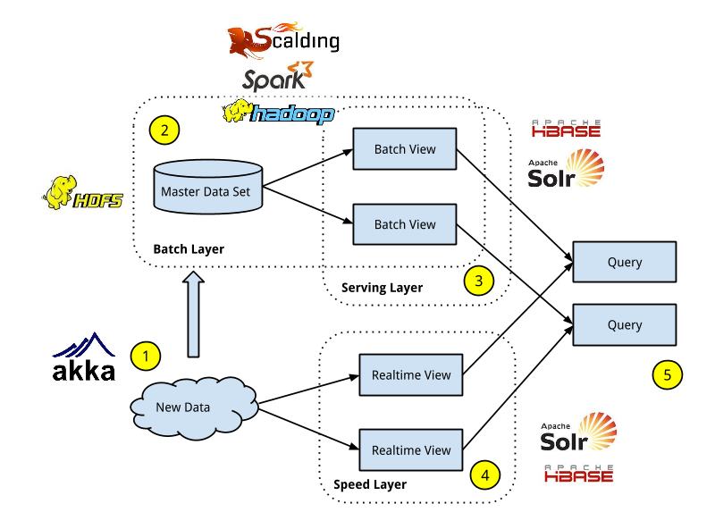

*This post is the second in a series of blog posts that will go in depth over our implementation of Lambda Architecture (LA) for building the big data pipeline at Indix.*

*The first [post]() introduced LA, our motivation for using it and the key architectural components and principles that form the basis of implementing LA. In this post, I will talk about the framework and the abstractions that form the core of the compute part of our batch layer implementation.*

### Recap



In the Lambda Architecture, the batch layer is responsible for computing arbitrary functions on the master data and creating batch views so that queries can be resolved with low latency.

The batch layer has two key components – the compute (processing) and storage. In this particular blog post, we will focus on the compute component. We will cover the storage layer in a subsequent blog post.

### Batch layer – Compute Requirements

The compute component is responsible for running precomputes on the entire master data set which in our case is in several tera bytes. Our machine learning algorithms and models are constantly changing. To make it predictable we run it daily.

Given the above, there are three key requirements of the compute component in the batch layer
– Scalability – It should scale linearly i.e. maintain the performance with increased load by adding more resources in proportion to the increase in load. – Fault Tolerance – It should be tolerant to faults associated with distributed systems like network partitions, disk failures and server crashes. – Generality – It should be expressive enough to support any arbitrary functions on the master data.

### Batch layer compute framework – MapReduce

MapReduce satisifies all the requirements of compute part of the batch layer I described above.

MapReduce is a programming model and infrastructure for doing parallelized distributed computing on server clusters. It has its roots in the functional programming world, specifically, higher order functions. Google took it from there and showed how these abstractions can be used to do massive parallelized computations. This is the basis of Apache Hadoop, the open source Big Data infrastructure platform that is used by several companies world-wide.

I will not be covering MapReduce in this blog post as there are several tutorials out there that can explain the fundamentals. However, the rest of the post assumes an understanding of core ideas behing MapReduce. So if you are not aware of MapReduce or need to brush up on its basics, I highly recommend the two links below.

- [Google Paper Introducing MapReduce (2005)](http://static.googleusercontent.com/media/research.google.com/en//archive/mapreduce-osdi04.pdf)
- [Yahoo Developer Tutorial](https://developer.yahoo.com/hadoop/tutorial/module4.html)

### MapReduce @ Indix

By May 2012, we had a 10-node hadoop cluster setup on AWS that was available for the team to run MapReduce tasks. In about a month, we had several MapReduce jobs running that were

By June 2014, we have around 120 MapReduce jobs runnning on a 100 node AWS cluster doing data transformations, training and evaluating models, running precomputations, creating indexes, finding duplicates among other things.

### First cut – Using vanilla MapReduce API

The initial 30 or so MapReduce jobs were written by us using the vanilla MapReduce Java API. After writing a handful of these jobs we noticed that there was lot of boiler plate code being written for each job and we had to write quite a bit of plumbing code to express complex data workflows. We were unable to compose and hence re-use lot of the logic that was contained in those jobs.We soon realized that there was a need for a different paradigm,library or language to express high level user defined functions.

We would still not trade the time we spent using the vanilla API. It taught us some valuable lessons and we gained deep knowledge into the inner workings of Hadoop MapReduce infrastructure that helped us while working with higher level abstractions. Its a dangerous thing to ignore the details while working on higher level abstractions.

### Second cut – Using PIG

The first such abstraction we tried was PIG. PIG from Yahoo is a relational data-flow language. It provides a DSL, called Pig Latin, on top of vanilla MapReduce. The interface it provides has nothing to do with “map” and “reduce”. The Pig Latin DSL commands are interpreted into a series of MapReduce jobs. Its very similar to a query planner in an RDBMS that translates SQL into a series of operations on data. It supports UDFs(User Defined Functions), loadable via Java classes for extending functionality thats not provided out of the box. We tried PIG for running ad-hoc jobs on our entire data. It was easy to read and learn. It exceled at simple data flows and was good for running ad-hoc tasks. However, it was inefficient for implementing non-trivial algorithms that could be used in production pipelines. Writing UDFs, the main building blocks in PIG, was painful because they needed to be written and compiled in a language (Java) other than the main query language (Pig Latin).

We did not use HIVE, an SQL like dialect on MapReduce, but the same arguments can be made for it.

### Enter Scalding

Scalding is a domain-specific language (DSL), that offers a higher level of abstraction on MapReduce by leveraging the power of Scala. Its an open source library from Twitter, and is built on top of Cascading. The Scalding DSL is very similar to the Scala collections API. The same code that works on a small list of records could be used to work on a stream of billions of tuples. The best part is that you can use functions in Scala to incorporate your business logic in the queries.

### Useful Links

To understand Scalding better, one needs a basic understanding of the Scala language and also a high level overview of the important concepts used in Cascading. I will recommend reading the following links

- Scala
  - [Twitter Scala School](http://twitter.github.com/scala_school/)
  - [Scala Functional Programming Course](https://www.coursera.org/course/progfun)
- Cascading
  - [Cascading for the Impatient](http://docs.cascading.org/impatient/)

### Motivating Example for Scalding

To get a sense of the benefits of using Scalding, let’s try to look at the solution of a simple problem in both Scalding and the Java MapReduce API.

The problem we will solve is an important building block in Text Analysis. Given a list of sentences, find the frequency of words and pick the top K when sorted in descending order of count of frequency. You should also filter stop words (for simplicity, we will define stop words as the words that have a length that is 2 or less)

For example, given the below input and a K value of 5

```scala
mary had a little lamb
twinkle twinkle little star
```

we need to return the following output

```scala
2   twinkle
2   little
1   star
1   mary
1   lamb
```

The final requirement is that this code should scale to work on a data set containing billions of words.

### Using Java Map Reduce API

Lets try to see how you would write a job to do for this using the Java MapReduce API. The map function gets each line as an input. It splits the line into words (using space as the delimiter), filters stop words and emits a key value tuple containing the word and its count as 1.

```scala
    public static class FrequencyCounterMapper extends Mapper<IntWritable, Text, Text, IntWritable> {

        @Override
        protected void map(IntWritable key, Text value, Context context) throws IOException, InterruptedException {
            String line = value.toString();
            String[] words = line.split(" ");
            List<String> cleanedWords = new ArrayList<String>();

            for (String word : words) {
                if(word.trim().length() > 2)
                    cleanedWords.add(word.trim().toLowerCase());
            }

            for (String cleanedWord : cleanedWords) {
                context.write(new Text(cleanedWord), new IntWritable(1));
            }
        }
    }
```

The reduce function gets a list of tuples grouped by the same word. It then sums up the values in the key value tuple to get the frequency for each word.

```scala
public static class FrequencyCounterReducer extends Reducer<Text, IntWritable, Text, IntWritable> {
    @Override
    protected void reduce(Text key, Iterable<IntWritable> values, Context context) throws IOException, InterruptedException {
        int sum = 0;
        for (IntWritable value : values) {
            sum += value.get();
        }
        context.write(key, new IntWritable(sum));
    }
}
```

The main function is responsible for executing the job by calling the run function. Within the run function, we create the job by giving it a name, specifying the mapper and reducer classes,setting the input and output file paths and providing classes describing how the input and output will be formatted.

```scala
public static void main(String[] args) throws Exception {
    new WordFrequencyJob().run(args);
}

private Job createJob(String inPath, String outPath) throws IOException {
    String jobName = "Word Frequency in Vanilla MR";
    Job job = new Job(getConf());
    job.setJobName(jobName.trim());

    job.setMapSpeculativeExecution(false);
    job.setMapperClass(FrequencyCounterMapper.class);
    job.setReducerClass(FrequencyCounterReducer.class);

    job.setInputFormatClass(TextInputFormat.class);
    TextInputFormat.setInputPaths(job, inPath);

    job.setOutputFormatClass(TextOutputFormat.class);
    TextOutputFormat.setOutputPath(job, new Path(outPath));

    job.setJarByClass(this.getClass());
    return job;
}

@Override
public int run(String[] args) throws Exception {
    Job job = createJob(args[0], args[1]);
    if(job.waitForCompletion(true))
        return 0;
    else
        return -1;
}
}
```

Now, we’ve the word frequencies as output. We should be able to process this and get top-k frequent words from this. Note that, we also want to know what these top-k words’ frequencies are. We would be writing another MR job that gives us Top-K words based on their frequencies.

The map function for this MR job is a little involved. The Mapper class maintains an in-memory TreeMap which allows the map input to be sorted based on its key. We use it so that, we can maintain only top K words in the mapper class and keep removing words which fall below the top K. What this has done to us is, reduced the amount of shuffle that would otherwise happen b/w the map and the reduce phase. Note the Mapper task Type – It takes Text, IntWritable as its input K,V and produces NullWritable, WordFrequencyWritable(a custom writable that would contain both word and its frequency) as the output K,V. NullWritable is the Writable equivalent of null.

```scala
class WordFrequencyWritable implements Writable {
    int count;
    String word;

    @Override
    public void write(DataOutput dataOutput) throws IOException {
        dataOutput.writeInt(count);
        dataOutput.writeInt(word.length());
        dataOutput.write(word.getBytes());
    }

    @Override
    public void readFields(DataInput dataInput) throws IOException {
        count = dataInput.readInt();
        int length = dataInput.readInt();
        byte[] b = new byte[length];
        dataInput.readFully(b);
        word = new String(b);
    }

    // Needed For the deserialization at reducer
    WordFrequencyWritable(){}
    WordFrequencyWritable(int count, String word) {
        this.count = count;
        this.word = word;
    }
}

public static class TopKMapper extends Mapper<Text, IntWritable, NullWritable, WordFrequencyWritable> {
    TreeMap<IntWritable, List<Text>> freqMap = new TreeMap<IntWritable, List<Text>>();
    @Override
    protected void map(Text key, IntWritable value, Context context) throws IOException, InterruptedException {
        if (freqMap.containsKey(value)){
            freqMap.get(value).add(key);
        }else{
            List<Text> words = new ArrayList<Text>();
            words.add(key);
            freqMap.put(value, words);
        }

        // We don't have to exactly do Top K on mappers.
        // So, we are approximating things here.
        if(freqMap.size() > K){
            freqMap.remove(freqMap.firstKey());
        }
        // keep alive
        context.progress();
    }

    @Override
    protected void cleanup(Context context) throws IOException, InterruptedException {
        for (IntWritable key : freqMap.keySet()) {
            List<Text> words = freqMap.get(key);
            for (Text word : words) {
                // because we want to have the word and its frequency; we construct the Writable
                context.write(null, new WordFrequencyWritable(key.get(), word.toString()));
            }
        }
        super.cleanup(context);
    }
}
```

 

The reducer(only one in this case) runs through all the Top-K WordFrequencyWritables got from all the mappers and produces Top K amongst them. Note that, since the key from the mappers were all null, all output would go to only one reducer and hence we are able to do Top K with total ordering.

```scala
public static class TopKReducer extends Reducer<NullWritable, WordFrequencyWritable, Text, IntWritable> {
    TreeMap<Integer, List<String>> freqMap = new TreeMap<Integer, List<String>>();

    @Override
    protected void reduce(NullWritable key, Iterable<WordFrequencyWritable> values, Context context) throws IOException, InterruptedException {
        for (WordFrequencyWritable value : values) {
            if (freqMap.containsKey(value.count)){
                List<String> words = freqMap.get(value.count);
                words.add(value.word);
            }else{
                List<String> words = new ArrayList<String>();
                words.add(value.word);
                freqMap.put(value.count, words);
            }

            if(freqMap.size() > K){
                freqMap.remove(freqMap.firstKey());
            }
            // keep alive
            context.progress();
        }
    }

    @Override
    protected void cleanup(Context context) throws IOException, InterruptedException {
        NavigableSet<Integer> keys = freqMap.descendingKeySet();
        int count = 0;
        for (Integer key : keys) {
            List<String> words = freqMap.get(key);
            for (String word : words) {
                count++;
                if(count > K){
                    break;
                }
                context.write(new Text(word), new IntWritable(key));
            }

            if(count > K)
                break;
        }
    }
}
```

 

The main function is responsible for executing the job by calling the run function. Within the run function, we create the Word Frequency job by giving it a name, specifying the mapper and reducer classes, setting the input and output file paths and providing classes describing how the input and output will be formatted. Once this job completes, based on the status code, we create another job responsible for providing us the TopK result. This pattern is typically called Chaining. We finally return an exit code based on the success/failure of the job.

```scala
public static void main(String[] args) throws Exception {
    new WordFrequencyJob().run(args);
}

private Job createJob(String inPath, String outPath) throws IOException {
    String jobName = "Word Frequency in Vanilla MR";
    Job job = new Job(getConf());
    job.setJobName(jobName.trim());

    job.setMapSpeculativeExecution(false);
    job.setMapperClass(FrequencyCounterMapper.class);
    job.setReducerClass(FrequencyCounterReducer.class);

    job.setInputFormatClass(TextInputFormat.class);
    TextInputFormat.setInputPaths(job, inPath);

    job.setOutputFormatClass(TextOutputFormat.class);
    TextOutputFormat.setOutputPath(job, new Path(outPath));

    job.setJarByClass(this.getClass());
    return job;
}

private Job createTopKJob(String inPath, String outPath) throws IOException {
    String jobName = "Top K Vanilla MR";
    Job job = new Job(getConf());
    job.setJobName(jobName.trim());

    job.setMapSpeculativeExecution(false);
    job.setMapperClass(TopKMapper.class);
    job.setReducerClass(TopKReducer.class);
    // Because we want only the TopK, it should be reasonable to assume that,
    // sending data to one reducer would not create any scale problems
    job.setNumReduceTasks(1);

    job.setInputFormatClass(TextInputFormat.class);
    TextInputFormat.setInputPaths(job, inPath);

    job.setOutputFormatClass(TextOutputFormat.class);
    TextOutputFormat.setOutputPath(job, new Path(outPath));

    job.setJarByClass(this.getClass());
    return job;
}

@Override
public int run(String[] args) throws Exception {
    Job job = createJob(args[0], args[1]);
    if(job.waitForCompletion(true))
        return createTopKJob(args[1], args[2]).waitForCompletion(true) ? 0 : -1;
    else
        return -1;
}
}
```

 

### Using Scalding

Now lets look at writing the same job using Scalding. The code below reads in a text file, outputs every word in a line, filters the stop words, counts the frequency of each word, sorts them in the descending order of frequency and writes these word frequency tuples to a TSV file.

```scala
class WordFrequencyJob(args: Args) extends Job(args) {

  TextLine(args("input"))
  .flatMap('line -> 'word)(tokenize)
  .filter('line)(!stopWord)
  .groupBy('word) { _.size('frequency) }
  .groupAll(_.sortedReverseTake(('frequency, 'word), args("K")))
  .write(Tsv(args("output"), ('word, 'frequency)))

  def tokenize(line: String) = line.split(" ").map(_.trim).filterNot(_.isEmpty)
  def stopWord(word: String) = word.length <= 2

}
```

 

Let’s try to dissect this code line by line.

### Textline

Textline is an example of a Scalding source which contains the input data. In this case the source is a text file. You could also read from a TSV file, Thrift or Protobuf encoded records from HDFS or database records from MySQL.

```scala
//args input contains the filename to read from
TextLine(args("input"))
```

 

### flatMap

flatMap applies the function gives as is argument to a stream of tuples. We define a symbol line, the placeholder for the input and another symbol word, the placeholder for the output. We then specify the tokenize function that describes how to flatmap over the input. The tokenize function takes the line as input and returns a list of words as output.

```scala
.flatMap('line -> 'word) (tokenize)
```

```scala
def tokenize(line: String) = line.split(" ").map(_.trim).filterNot(_.isEmpty)
```

 

*Note* – This is a good example where the UDF equivalent function is defined inline in Scala itself.

### filter

filter applies the predicate function passed to it and filters out all tuples that do not satisfy that predicate. In this case, all words that are not stop words are filtered out.

```scala
.filter(!stopWord)
```

```scala
def stopWord(word: String) = word.length <= 2
```

 

### groupBy

groupBy groups similar words together and counts the size of each group. We also specify a new field frequency that contains the size for each word.

```scala
.groupBy('word) { _.size('frequency) }
```

 

### groupAll

groupAll groups all records together and sends them to one reducer. After we’ve all records at one place, we sort them by the frequency field and then the word field in descending order(note the reverse) and pick the first K from it.

```scala
.groupAll(_.sortedReverseTake(('frequency, 'word), args("K")))
```

 

### write

write allows you to write the data to a source. In this case we are writing to a TSV source.

```scala
.write(Tsv(args("output"), ('word, 'frequency)))
```

 

You can run this job by using [scald.rb](https://github.com/twitter/scalding/wiki/Scald.rb) or in the newly released [Scalding REPL](https://github.com/twitter/scalding/wiki/Scalding-REPL).

As you can see, Scalding brings you the advantages of the Scala language like conciseness and higher order functions to your MapReduce jobs. We were able to write a job that took 100+ lines of code in Java MapReduce using Scalding in about 10 lines.

### Everything is not rosy with abstractions

There are some practical issues that arise when using higher level abstractions. Its important to be aware of these issues when you are working with one. Most importantly, the full power of the underlying API may not be available for various reasons. For example, because of certain design choices made in the implementation of the abstraction, its either harder, in which case it takes time or sometimes even not possible, to implement certain features. Another example is when the development speed of the abstraction lags significantly behind the underlying API.

Specifically with Scalding, we faced the following two issues

- We started using Scalding 0.8 for developing the initial set of our jobs. Job counter support, which provides useful metrics for a job, was not easy to implement in Scalding 0.8. In order to get the counters exposed at the job layer with the map/filter/groupBy abstractions, we had to expose a new set of ‘rich’ apis that provided an instance of FlowProcess(from the Cascading layer) that would provide access to counters. We ended up writing our own Scalding extension library which has richMap, richFilter and richGroupBy apis that allow the jobs to update counters. This library is now obsolete as Scalding version 0.9 onwards have first class support for job counters.
- Since Scalding is built on top of Cascading, which itself was built on the hadoop MapReduce, there as an extra level of indirection between Scalding and the Hadoop MapReduce API. What that means is that the features that are in Hadoop right now will take anywhere from few weeks to months to make it into Scalding. For example, Cascading 3.0 has Apache Tez support, its still not available in Scalding yet because its using Cascading 2.5.5 and has not upgraded to Cascading 3.0. Similarly, Hadoop YARN was available for a while before Cascading 2.5 and hence Scalding got support for it.

### Summary

Using the MapReduce paradigm, we were able to scale our batch layer to work with terabytes of data. The linear scalabilty feature of MapReduce made it easy for us to maintain predictable job run times by adding the corresponding number of nodes in our compute cluster. In addition, the generality of MapReduce allows us to use it for multiple jobs running several differet data transformations and varied set of algorithms.

Finally, by using Scalding to express our MapReduce computations we are able to write code that is less complex, composable and error free.
