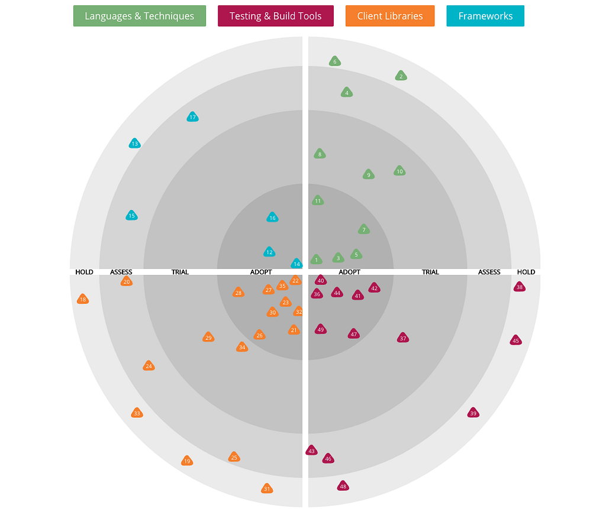
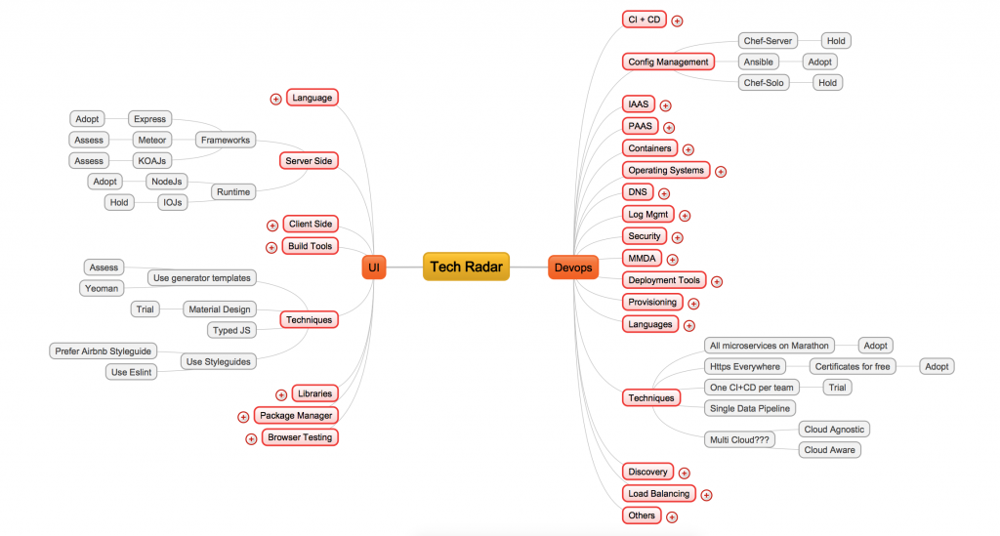

About 10 years ago, I was working on Microsoft Technologies at a startup. Making technology choices was not very hard back then. Microsoft had a library, product, or framework to fulfill every developer need: database — SQL Server, IDE — Visual Studio.NET, language — C#, framework — .NET, source control — TFS, deployment — NANT scripts. We would hardly debate on these choices. Most of the technical discussions would be around design and architecture.

However, things have changed dramatically since then. There are a lot more choices today especially with open source technologies. Having choices is good, but the wrong choice can put a project in trouble. You can balance some of it with sound architecture or you can leave it until the last possible moment, but there is always a risk when the wrong technology choice is made.

In most organizations, these choices are mostly ad-hoc without a formal process. The decisions behind the choices are neither documented well nor are they communicated well to other teams or external stakeholders. And when a different team needs to choose a technology for a similar use case, they follow the same ad-hoc process and more often than not make the same mistakes.

We were seeing this happen at Indix as well. Given the fact that we work on some hard problems in the area of distributed systems, machine learning, and data infrastructure, we have a lot of choices to make, and not all technologies have reached a level of maturity that make them a no-brainer for most use cases.

So we were looking for a lightweight framework that would help us assess technology choices in a more formal and objective way rather than in an ad-hoc way. We also wanted a way to communicate these choices in the best possible way across teams as well as to non-technical folks. Finally, we wanted something that would provide us with a visual snapshot of all the technologies we were using and where they were in the adoption life cycle at any given point of time.

### Indix Tech Radar?

[ThoughtWorks](https://www.thoughtworks.com/) has been publishing their [Technology Radar](https://www.thoughtworks.com/radar) since April 2010. According to their [FAQ](https://www.thoughtworks.com/radar/faq),

“The radar is a document that sets out the changes that we think are currently interesting in software development — things in motion that we think you should pay attention to and consider using in your projects. It reflects the idiosyncratic opinion of a bunch of senior technologists based on our day-to-day work and experiences.”

If we could take the concepts from the radar and customize them to our technology stack, it seemed like it could alleviate some of the issues around assessing and communicating technology choices across Indix. Fortunately for us, an [article](http://nealford.com/memeagora/2013/05/28/build_your_own_technology_radar.html) by Neal Ford outlining the process to build your own technology radar and an open source [repository](https://github.com/thoughtworks/build-your-own-radar) for visualization gave us a good head start.

### What Are the Components of a Technology Radar?

A Technology Radar helps you visualize technologies on a radar graph. There are three major components — blips, quadrants, and rings.

There are four quadrants in a radar — Tools, Platforms, Languages and Techniques, and Frameworks. Each technology is called a blip and is put into one of these quadrants. The quadrants can be customized according to your technology stack.

Each of these quadrants are further subdivided into rings. There are four rings and a blip can belong to only of these rings. The four rings are:

1\) **Hold**: technologies in this ring are not to be used for starting anything new in any of our projects. These typically fall under two buckets — technologies that were once used heavily earlier but have now reached their end of life, and technologies that never went mainstream due to reasons like lack of adoption, lack of features, or availability of a better alternative. There are also cases where due to the licensing restrictions, for example GPL, we might put a framework or library on hold.

2\) **Assess**: blips in this ring need research. We have heard about them in the community or our developers have tried them in their pet projects, but the judgement on whether these technologies are here to stay or not is still reserved until it we try it in a real project.

3\) **Trial**: these blips are mature enough to be battle tested in projects. At least one of the teams should be using it to understand the benefits and limitations.

4\) **Adopt**: blips in this ring should be followed and used. ThoughtWorks describes these as “as close to no-brainer as possible”. Also, nothing moves directly into Adopt. Every blip has to go through at least the Trial ring before it moves to Adopt.

### Building the Radar

At Indix, we have quarterly [hackathons](https://www.indix.com/blog/life-at-indix/highlights-from-second-indix-internal-hackathon-of-2016/) for two days, where everyone works on their own ideas that they think will make the product better or improve efficiency across a function like engineering, for example. I used that opportunity to build an alpha version of the DevOps and Front End Development radars on a mind-map (see image below), and subsequently demoed it during the hackathon.

Next part of the process was to get opinions from a larger audience at Indix. I used our bi-weekly engineering leads meetings as a forum for further feedback. Over the course of four such meetings, which I moderated, we debated about everything from the quadrants to the rings that blips should be in. We had some great discussions during those meetings. When opinions were shared, it was easy for me as a moderator but when they differed, my job was to make sure that we all reached a consensus.

The next step was to add a short description and our opinion about each of the blips in the radar. That job was taken over by the respective leads responsible for DevOps and Front End Development at Indix.

### Usage of the Radar at Indix

One of the obvious uses of the radar at Indix is for making technology choices. The radar has helped us formalize our opinions on technologies across the entire organization. It has allowed engineers to make choices quickly in cases where earlier there would be lot of time spent in debates, discussions, or in evaluations.

A good example of this is the DevOps Radar under the Configuration Management (CM) section in the Tools quadrant. We were heavily invested in Chef-Server as our default choice for CM, but it had issues with stability and maintenance primarily due to multiple moving parts involved. One of the teams trialed Ansible with good success and a couple of other teams moved to it. Since we had two options for CM and because it wasn’t formally known to everyone what the official organization stand on those two was, it wasn’t obvious what to choose as CM while starting a new project. The radar helped us formalize it when Chef-Server was moved to Hold and Ansible was moved into the Adopt ring.

Another useful area has been around prioritizing technical debts. The radar has been used as a guidance by teams to prioritize code bases that are using technologies in the Hold ring to migrate to using technologies in the Adopt ring.

We have also used the radar during interviews where we compared our radar to what a candidate has worked on to understand their breadth, and then go deeper into some of those technologies to understand their opinions, thereby allowing us to assess their depth of knowledge.

### What’s Next?

We are publishing two radars today — DevOps and Front End Engineering. [Click here](http://oss.indix.com/indix-radar/) to browse through them. The code used to build them is available [here](https://github.com/indix/indix-radar).

We would like to maintain a cadence of updating these radars every six months based on what we learn. In addition to these radars, we are also planning to release a radar for Big Data in the coming weeks. Stay tuned.

Please note that the opinions about technologies are our own and are based on our usage. However, feel free to raise an issue or post a comment if you think something is not right, or if you think there is a different technology we should look at as an alternative to what is already on the radar.

### Acknowledgements

Thanks to Ashwanth Kumar, Arijit Bhattacharya, Manoj Mahalingam, Naween Ghimire, and Vasanth Gopal for help with the content of the two radars.

Special thanks to Betleharaja G and Ganesh Prasannah for their work on the tech-radar repository

*If you have been following this space, you must be aware that* [*Indix loves open source*](https://www.indix.com/blog/developer/indix-loves-open-source/)*. We use a lot of open source projects, and are also committed to contributing back to the community. Check out our other work at* [*oss.indix.com*](http://oss.indix.com/)*.*
